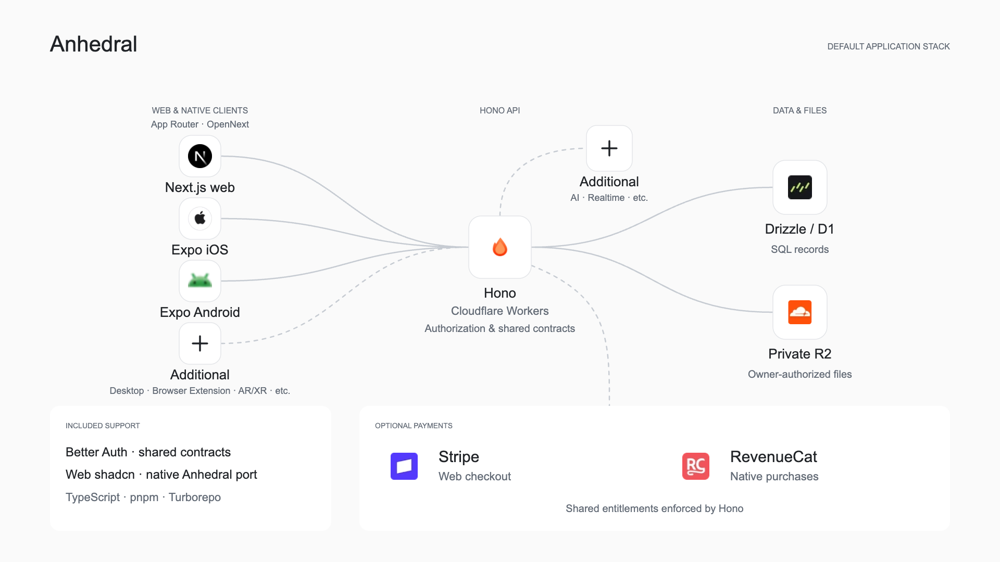

# Anhedral CLI

Anhedral CLI is the starter foundation for applications built with Anhedral. It brings web, iOS, Android, backend services, authentication, data storage, and shared design foundations into one maintained application stack. Generated projects contain editable source, established architectural boundaries, and the configuration and development conventions needed to build on that foundation.

The CLI gives each application a consistent starting point that Anhedral Agents and developers can extend together, carrying a shared architecture from initial setup into ongoing development and cloud delivery.

Anhedral Platform is the shared workspace for collaboration, planning, and software delivery. Anhedral Agents is the orchestration layer for programming agents, isolated development environments, and source management. Anhedral Cloud is the managed hosting and application services layer. See the [Anhedral product family](https://www.anhedral.com/work) for how they fit together.

Anhedral is open source under the [Apache License 2.0](LICENSE).
Generated applications are editable source that developers can customize and license for their products.

One command creates one stack:

- **Next.js App Router** for the web, with DOM shadcn UI and Cloudflare OpenNext.
- **Expo** for iOS and Android, with the Anhedral-maintained native shadcn port using StyleSheet and shared tokens.
- **Hono** on Cloudflare Workers for application APIs and authorization.
- **Drizzle / D1** for SQL persistence and explicit migrations.
- **Private R2** for authenticated, owner-scoped files.
- Supporting Better Auth sessions, shared public contracts and design tokens.

The Expo component inventory, native API differences, tests and device acceptance checklist are maintained in [Native UI](docs/native-ui.md). The [official-registry checklist](docs/native-registry.md) tracks the larger, still-in-progress registry port. Canonical source lives in `assets/ui/native/` and is copied into generated `packages/native-ui`.

The only optional additions are **Stripe** for web billing and **RevenueCat** for native purchases. They can be selected independently or together. Provider accounts, activation, product configuration and acceptance remain explicit work.

<picture>
  <source media="(prefers-color-scheme: dark)" srcset="docs/assets/anhedral-stack.png">
  <source media="(prefers-color-scheme: light)" srcset="docs/assets/anhedral-stack-light.png">
  
</picture>

CLI 0.15.0 is published on npm. Install the exact release with
`npm install --global anhedral@0.15.0`, then use the commands below.
For source development, run `pnpm install --frozen-lockfile && pnpm build` and
replace `anhedral` with `node /path/to/anhedral-cli/dist/bin.js`.
Keep existing applications on their recorded CLI version; publication does not
upgrade an installed plugin or a Platform runtime image.

```sh
node /path/to/anhedral-cli/dist/bin.js init my-app
cd my-app
pnpm dev
```

Initialization writes source locally, installs dependencies and initializes Git unless requested otherwise. Generation does not create cloud resources, apply remote migrations or deploy.

```sh
anhedral init my-app --dry-run --json
anhedral init my-app --stripe --revenuecat
anhedral add stripe --cwd my-app --dry-run --json
anhedral add stripe --cwd my-app
```

Use `--skip-install --no-git` for source-only generation. This mode requires no network. Keep the project CLI version pinned before applying additions; edited-source conflicts are preserved rather than overwritten.

Deployable applications live in `apps/web`, `apps/mobile` and `apps/api`; shared contracts, database, auth and styling live in `packages`. The API owns data access and authorization. Clients never receive provider management credentials.

Read the [stack standard](docs/stack-standard.md), [development and delivery workflow](docs/software-factory.md), [architecture diagram](docs/anhedral-stack.md), and [verification record](docs/verification.md).

Version 0.15 separates Next.js web from Expo native. Web uses the full App Router with SSR and React Server Components through OpenNext; Expo has no browser build. The focused catalog retains only Stripe and RevenueCat additions. Existing applications are not automatically migrated or reinitialized; retain their pinned older CLI until a reviewed migration is available. Historical versions remain in Git history and release tags.
