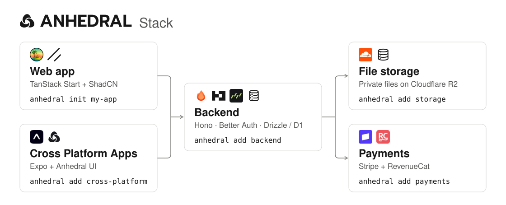

# Anhedral CLI

> [!WARNING]
> **Under heavy construction.** CLI commands and generated app code may change.

Start with a blank pnpm/Turborepo workspace and add the clients and services your app needs. Generated applications are editable source.

<picture>
  <source media="(prefers-color-scheme: dark)" srcset="docs/assets/anhedral-stack.svg">
  
</picture>

## Build a project

```sh
anhedral init my-app
cd my-app
anhedral add web api db auth
anhedral add mobile desktop web-extension
anhedral add storage client-sync
anhedral stack doctor
```

Add clients before or after the backend. Once both sides are present, the CLI wires them together. Signed-in clients subscribe to the same account’s events. After a successful mutation, Hono can notify the account’s Durable Object. Connected clients update immediately and refetch current state when they reconnect.

Use `add cli` for a TypeScript Commander executable, `add payment` for Stripe, `add in-app-purchases` for RevenueCat, or `add rtc` for RealtimeKit calls. To generate everything at once, run `anhedral init all my-app`. Preview either path with `--dry-run --json`.

The local checkout includes 14 cumulative snapshots under `examples/progression/`, from blank init through all 13 individual additions. For each command’s prerequisites, integrations and official documentation, see the [stack guide](docs/capabilities.md). Browse the [released examples](https://github.com/anhedral/anhedral-cli/tree/v0.24.1/examples).

Init and add resolve compatible stable dependencies at generation time and write exact pins. Use `--catalog-pins` to reproduce the catalog baseline.

For an existing project, run `anhedral stack update --dry-run --human` to compare installed stack pins with the proposed versions. The printed apply command updates the manifests and lockfiles together. [Updating an existing app](docs/capabilities.md#updating-an-existing-app)

Upgrading from 0.22.1? Replace `add r2` with `add storage` and `add stripe` with `add payment`. Existing projects keep their R2 and Stripe configuration.

### Command reference

Use `pnpm dlx anhedral@latest <command>`. For arguments and flags, run `pnpm dlx anhedral@latest help <command>`.

| Task | Commands |
| --- | --- |
| Generate source | `init`, `add` |
| Inspect or update the stack | `stack list`, `stack status`, `stack doctor`, `stack update` |
| Manage your session | `login`, `whoami`, `logout` |
| Connect a project | `projects list`, `projects create`, `link`, `unlink` |
| Contribute to project Messages | `messages list`, `messages read`, `messages post` |
| Share handoffs with agents | `reports brief`, `reports submit`, `reports connect`, `reports dispatch` |
| Upload source | `source upload`, `source status` |
| Configure environment variables | `env list`, `env set`, `env import` |
| Prepare a deployment | `deploy plan`, `deploy prepare`, `deploy status` |
| Deploy to staging | `staging deploy`, `staging status` |
| Publish to production | `production deploy`, `production status` |
| Read runtime logs | `logs` |
| Get help and shell completions | `help`, `--version`, `completion bash`, `completion zsh` |

Use the CLI directly or through the Codex and Claude Code plugin. To host on Anhedral, sign in, link a project, upload source, and deploy. [Platform workflow](docs/software-factory.md) · [Stack reference](docs/stack-standard.md)

Apache-2.0. Retain the included third-party notices when distributing generated source.
