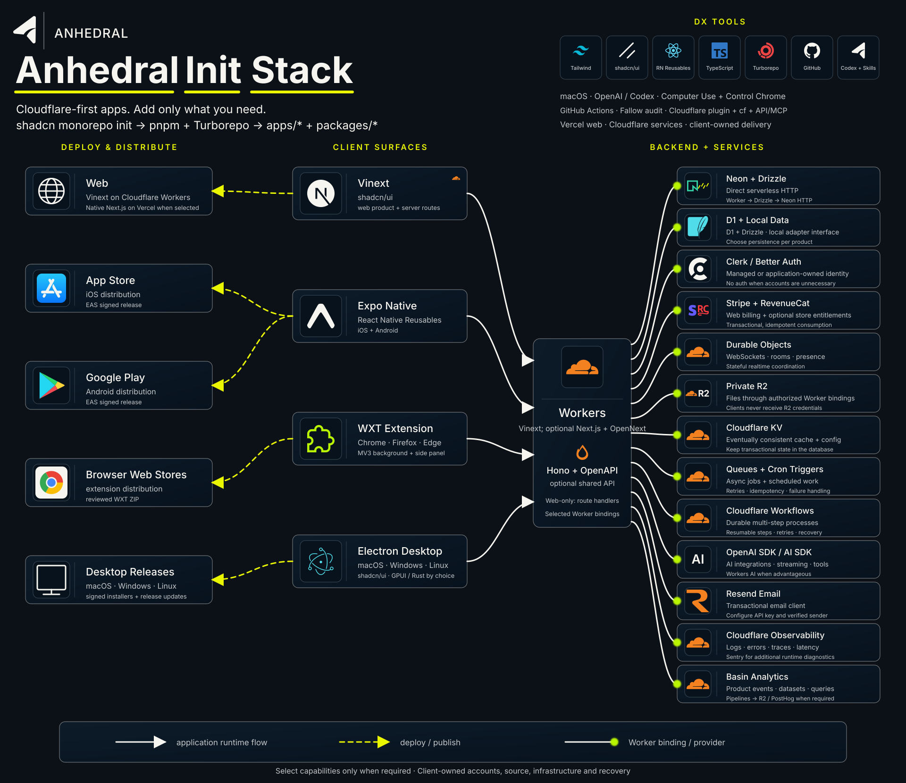

# Anhedral

[](https://github.com/anhedral/anhedral-cli/actions/workflows/ci.yml)
[](https://www.npmjs.com/package/anhedral)
[](LICENSE)

Anhedral scaffolds source code, guides authentication, then provisions, configures, and deploys the supported stack automatically wherever provider APIs allow. Application features, design, custom integrations and business workflows remain development work; Anhedral offers development and ongoing maintenance services for businesses that want that work delivered for them.

1. **Describe the app** — Anhedral clarifies its purpose, users and essential features.
2. **Choose the architecture** — Explain the stack decisions; default web apps use Vinext on Cloudflare Workers.
3. **Set up ownership** — Use your own source repository and provider accounts; configure only the selected services.
4. **Build the app** — Implement the requested features, data, authentication and integrations.
5. **Check and ship** — Run checks, deploy, open the real URL and verify the live user flows.
6. **Maintain it** — Keep architecture, deployment history and verification visible; update or roll back as needed.

You own the code, infrastructure, data and billing.

Anhedral initializes a Vinext, React, TypeScript, Tailwind, shadcn/ui and Lucide workspace for Cloudflare Workers. D1 + Drizzle, Better Auth and Workers AI are the defaults when persistence, identity or inference are needed. Native Next.js on Vercel and Neon/PostgreSQL remain deliberate options. Choose the application surfaces and provider starters your product needs; the generated source stays yours to edit.

## Try it

Use `anhedral help <command>` for focused options and examples. Human output shows concise outcomes and next steps; `--json` preserves the complete result for scripts. `--cwd` / `-c` selects a project, and `--quiet` / `-q` suppresses human output while retaining errors and JSON. [CLI behavior and design](docs/cli-design.md) explains the comparison with shadcn, GitHub CLI and uv, and the source preview contract.

Install the plugin and select **Try now**. Use the CLI version pinned by its bundled registry. A local rewrite or ZIP does not update an installed plugin; unpublished development versions require their matching local CLI and skill.

Starter prompt:

> Create a new project using [@Anhedral](plugin://anhedral@anhedral). Start by explaining the stack and asking me what it should be about.

Codex asks about the app, explains the stack, implements the product, configures selected services, and delivers into your authorized accounts. The CLI commands below are also available independently.

Use Node.js 22.13+ on the 22.x line or Node.js 24+, with pnpm 10.34.5, for generated workspaces. Generate on Linux, macOS, or WSL.

```sh
# Inspect a plan first: no project files or cloud resources are created
pnpm dlx anhedral@latest init my-app --dry-run --json

# Generate the default Vinext/Workers workspace
pnpm dlx anhedral@latest init my-app
cd my-app
pnpm dev
```

The first command downloads the CLI through pnpm; the CLI's dry run performs no writes or network calls. Generation needs network access for the official shadcn bootstrap. The default selects Vinext on Cloudflare; add capabilities only when needed. Follow the generated README for provider setup, Worker builds, and preview deployment.

**If Anhedral is useful to you, [star the repository](https://github.com/anhedral/anhedral-cli) to help other developers discover it.**

## Initialize, authenticate and deliver

```sh
anhedral init my-app --hono --d1 --better-auth --r2
anhedral auth my-app
anhedral auth my-app --status --json
anhedral ship my-app --dry-run --json
anhedral ship my-app --json
```

`init` accepts a destination directory or initializes the current directory. Authentication requirements derive from the selected stack; Cloudflare requirements are deduplicated. Interactive authentication can open the supported Cloudflare, Vercel and Expo login flows. API-backed checks use credentials supplied through the environment; they do not read or print application secret files. Missing access and insufficient permissions remain explicit. A verified session or API endpoint does not establish every provisioning permission, the intended account connection or configured application secrets. Use the supported `connect` workflow to select hosting account, project and audience before delivery.

`init` writes a nonsecret `anhedral.providers.json` for the selected integrations. Complete its account/resource choices before shipping. Adapters provision and configure Neon, Clerk, Resend, Stripe webhooks, RevenueCat apps, Sentry, PostHog and OpenAI project/service-account resources. Management access, provider eligibility and owner prerequisites remain explicit. See [provider configuration](docs/provider-configuration.md) for supported operations, credentials, runtime configuration, recovery and verification limits.

Cloudflare `ship` runs checks before reconciling D1, R2, KV, Queue and private Basin stream resources. If provisioning changes tracked binding IDs, it stops before deployment: review and commit the configuration, then repeat `ship`. It never commits source automatically. Runtime credentials accompany the checked code deployment; Vercel receives the selected web runtime's production variables. In mixed projects default `ship` runs Cloudflare services before the Vercel web target; use `--provider cloudflare` or `--provider vercel` for an explicit target. Partial delivery is reported without an automatic cross-provider rollback. The operation journal records diagnostics; retries recheck prerequisites and use resource receipts rather than skipping recorded phases. Pending provider setup stops deployment. Authentication alone does not establish completed setup.

For an Expo project with an explicit owner/slug in `app.json` and the required signing configuration:

```sh
anhedral ship my-app --platform android --profile preview --json
anhedral ship my-app --platform ios --profile simulator --json
```

EAS project creation/linking stops for review and a source commit. Queued builds return their build-page link; repeat the same command to inspect the existing build without submitting another. Completed builds return their ID, artifact type and download URL after checking project and source identity. Android preview produces an APK; production normally produces an AAB. The simulator profile produces an iOS Simulator artifact, not a TestFlight upload. Production iOS builds require Apple signing credentials. No store submission is performed. Build success does not verify the app's feature behavior.

Private provisioning receipts and credentials stay in ignored `.anhedral/` state. Inspect them with `anhedral integrations status my-app --json`; its output is redacted and read-only. `integrations recover` verifies an explicitly selected pending resource and writes only its local completion receipt. Legacy entries without descriptors, changed configuration, and missing one-time credentials remain blocked. See [provider configuration](docs/provider-configuration.md) before attempting recovery or moving machines.

For Better Auth, configure the primary server's ignored private runtime file with a generated secret of at least 32 characters and its HTTPS public origin; POSIX file permissions must be `0600`. Older Wrangler configs must remove same-named plain auth variables before secrets can be deployed. Review and apply the generated database migrations; resource provisioning does not establish application authorization or completed features.

## Choose your stack

The bundled stack registry drives composition of every supported stack part. Run `anhedral inspect --json` for read-only stack/setup/delivery evidence. Run `anhedral registry capabilities --json` for the implemented scope, local evidence, and owner prerequisites. Live provider acceptance remains separate; Electron/WXT distribution and plugin live readers are not automated, and Expo delivery returns EAS artifacts without store submission. Run `anhedral registry list` or `anhedral registry view better-auth --json` to inspect items, destinations, dependencies and selection constraints. `init --dry-run --json` includes the resolved dependency graph. Scaffolding installs recipes in dependency order into `apps/*` and `packages/*`, validates local workspace references and cycles, and writes `anhedral.registry.json` with recipe versions and the resulting workspace graph. The same catalog is bundled with the plugin at build time. Generated `docs/stack.md` lists the current resolved options, targets, environment names, required setup and verification; additions refresh it without rewriting the application README.

Registry items are trusted recipes shipped in the CLI release: foundations, apps, services, shared packages and runtime integrations. They follow shadcn's source ownership and dependency composition practices; this catalog is an Anhedral schema, not a shadcn registry payload. Runtime-aware recipes coordinate bindings, manifests and auth routes across workspaces. Each registry entry owns its recipe, provider requirements, environment variables, bindings and composition rules. Resolved plans name the exact generated destinations, including runtime-dependent packages. Recipe versions follow the CLI release. The official shadcn bootstrap is pinned to 4.21.4; commit the generated source and lockfile to preserve the application artifact. Incremental `add` supports only the bundled catalog maintained and tested by Anhedral. External registries and customer-authored registry payloads are unsupported. Additions refuse to overwrite edited or untracked source; runtime relocation requires a deliberate migration.

Use additions after initialization:

```sh
anhedral add resend stripe --cwd my-app --dry-run --json
anhedral add resend stripe --cwd my-app --diff
anhedral add resend stripe --cwd my-app
anhedral registry list --json
anhedral registry capabilities --json
anhedral registry view resend --json
```

Review the dry-run file list and conflicts, then run the same addition without `--dry-run`. A preview that needs a new web foundation reports `bootstrapRequired: true` and `filesChecked: false`; it describes the selection and targets without running the upstream generator or checking generated-file conflicts. The actual addition checks conflicts in an isolated transaction before committing files. `--skip-install` still resolves the lockfile; run `pnpm install --frozen-lockfile` afterward to prepare dependencies. Final installs run the bundled workspace's dependency preparation hooks, including WXT and Electron setup. Projects must have matching CLI versions and scaffold fingerprints; older projects and receipts containing external items need a deliberate migration. Existing provider identities stay intact, and no provider resources are created.

Application recipes start from the official **shadcn pnpm/Turborepo monorepo**. The default creates **Vinext + React + TypeScript + Tailwind + shadcn/ui + Lucide**, targeting **Cloudflare Workers**. Select additional apps and services only when needed.

```sh
pnpm dlx anhedral@latest init my-app
pnpm dlx anhedral@latest init mobile-app --expo
pnpm dlx anhedral@latest init product --next --expo --hono --neon --clerk --r2
pnpm dlx anhedral@latest init --wxt
```

To use a local checkout, run `pnpm build`, then `node dist/bin.js init <directory>`.



Applications: `vinext`, `next`, `expo`, `electron`, `wxt`, `hono`.

Optional capabilities: `neon`, `d1`, `local-data`, `clerk`, `better-auth`, `r2`, `kv`, `realtime`, `queues`, `cron`, `workflows`, `openai`, `ai-sdk`, `workers-ai`, `resend`, `stripe`, `revenuecat`, `sentry`, `basin`, `posthog`, `styling`.

Hono provides an OpenAPI Worker when a shared API is selected. Web-only endpoints belong in Next.js route handlers. Selecting Cloudflare bindings with native Vercel hosting adds a Hono API. Workers services live under `apps/*`, reusable code under `packages/*`. Mobile-only, desktop-only, extension-only and API-only selections remove the unused Next.js starter after the shadcn bootstrap.

The stack standard prefers direct Neon serverless HTTP + Drizzle; Hyperdrive is optional for measured connection/latency needs or standard PostgreSQL drivers. D1 + Drizzle is the Worker-native SQLite option. Neon recipes use direct HTTP through the serverless driver on Workers and native Next.js. Interactive transactions require a reviewed WebSocket or PostgreSQL adapter. Use Neon’s non-pooled endpoint with Hyperdrive and disable correctness-sensitive query caching. Authentication is optional; Better Auth is preferred when identity is needed, and Clerk is a deliberate alternative. They are mutually exclusive. Better Auth requires an explicit database selection. Stripe is the web billing choice; RevenueCat is an optional addition for cross-store entitlements. Private files use R2 Worker bindings; clients never receive R2 credentials.

`--next` selects native Next.js on Vercel; `--next --hosting=cloudflare` explicitly selects OpenNext on Workers. There is one framework path, including simple websites, with no separate static generator. For Vercel, Hobby is currently free for personal non-commercial use within limits, while commercial use needs an eligible existing plan. Other frameworks, specialized compute and source/CI platforms require deliberate project adaptations.

`--dry-run --json` prints a plan without writes or network calls. `--skip-install` skips the final workspace installation; the official shadcn bootstrap still needs network access and can install dependencies. Generation resolves and retains a workspace lockfile. Commit it with the source.

Generated projects include `dev`, `build`, `lint`, `typecheck`, `test`, `audit`, `audit:full`, and `check`, plus GitHub Actions PR checks. Fallow is part of the deterministic gate. Tests run in workspaces that define them; add meaningful product and integration tests as behavior is implemented.

Provider packages and services are **starters**, not finished product features. Generated READMEs identify the remaining setup: resource IDs, migrations, product authorization, webhooks, native adapters and runtime SDK initialization. Initialization does not create cloud resources, activate billing, or deploy. Respect existing account, budget, audience and release authorization. Request only missing approval for paid activation, material spending, architecture changes or release.

## Control costs and runaway work

Anhedral's stack must make unexpected spending and runaway work difficult to trigger, easy to detect, and possible to stop. Choosing Vercel, Cloudflare, or another provider does not establish those protections. Treat the following as delivery requirements for each selected service; **the initializer does not automatically configure or verify all of them**.

| Common mistake                                                     | Basic instruction                                                                                                                                                    |
| ------------------------------------------------------------------ | -------------------------------------------------------------------------------------------------------------------------------------------------------------------- |
| Assuming a free tier or budget alert caps spending                 | Check what each service charges for. Set available spending limits and alerts, allow for enforcement delays, and identify costs without a hard cap.                  |
| Creating infinite loops in jobs, queues, schedules or alarms       | Define a stopping condition, deadline and maximum amount of work. Keep job processing separate from enqueueing, and prevent overlapping scheduled runs.              |
| Retrying forever or processing the same job twice                  | Limit retries and concurrency, add backoff, and make repeated processing safe. Move failed jobs to a dead-letter queue for investigation before replay.              |
| Scanning an entire database or writing repeatedly on every request | Use indexed lookups, bounded pagination and batches. Measure storage operations per user action and remove unnecessary work.                                         |
| Letting public traffic trigger unlimited paid operations           | Authorize expensive actions. Set user, tenant and total usage quotas for email, AI, uploads and background jobs; rate-limit public entry points.                     |
| Assuming caching or DDoS protection eliminates traffic costs       | Check request, bandwidth and image-processing charges. Optimize media, restrict transformations and protect direct access to origins.                                |
| Collecting unlimited logs, analytics or session recordings         | Collect only necessary events, sample high-volume data, and limit retention and ingestion. Keep test traffic separate.                                               |
| Testing with unrestricted production credentials                   | Separate environments and credentials. Mock paid services in routine tests and bound live test traffic. Review generated code and test failure paths before release. |
| Discovering runaway usage only when the bill arrives               | Monitor usage spikes and retries, assign an alert owner, and test an emergency stop for both web requests and background work.                                       |
| Assuming code rollback restores data                               | Keep backups and test restoration. Document how to stop work, recover data and resume safely.                                                                        |

Before delivery, record the budget and limits in the app's `docs/architecture.md`, and the tested controls, alert owner and recovery steps in `docs/verification.md`. Verify behavior under traffic spikes, duplicate jobs and service failures. Resolve exposure beyond the customer's authorized budget before enabling the workload.

## Build and deliver

Default Vinext/Workers apps have `anhedral.project.json`; explicit Next.js/Vercel apps have `anhedral.web.json`. Customer-account delivery is supported: configure the customer's account, implement the app and verify its actual deployment.

```sh
# Customer-account profile: review source/ignored secrets and commit the app first.
anhedral repository my-app --create --json  # Private GitHub repo when using this source workflow
anhedral connect my-app --audience private --allow-email owner@example.com
anhedral provision my-app --dry-run --json
anhedral provision my-app --json
# Apply reviewed migrations, configure secrets and implement the actual product.
anhedral ship my-app --dry-run --json
anhedral ship my-app --json
anhedral verify my-app --json
anhedral manage my-app --json
```


For explicit Next.js/Vercel, connect the intended customer scope and private audience with `--git`, run checks before an authorized source push, then `adopt --json` and `verify --json` after the actual production deployment. Use `ship` only when selecting CLI delivery rather than deploying the same Git change twice.

Account discovery selects the sole accessible account; use `--account <id>` for multiple accounts. D1, private R2, KV and Queues are reconciled idempotently. Selected API integrations use the bounded adapters documented in [provider configuration](docs/provider-configuration.md). Private hosting requires Cloudflare Zero Trust and scoped Access permissions; protection covers the whole Worker before product deployment. Whole-Worker Access currently excludes WebSockets, which need a deliberate alternative access workflow.

Shipping requires a clean app source commit, runs checks, captures actual URLs and versions, and confirms 100% provider traffic. Failures preserve partial-operation evidence. `status --refresh` verifies current state. `rollback --release <id> --data-compatible` restores recorded code versions after schema/resource compatibility review; it does not restore data.

For a Git-triggered production release, run checks before pushing, then `adopt --json` after it becomes active instead of deploying the same commit again. Use `recover --json` after a fresh clone to reconcile current provider state; historical acceptance is not invented. `manage` produces a local overview from provider evidence. See the [delivery workflow](docs/delivery-workflow.md) for account setup, live verification and recovery.

## Inspect setup and compatibility

The CLI supports `init`, `auth`, `new`, `add`, `registry`, `doctor`, `repository`, `register`, `connect`, `provision`, `ship`, `adopt`, `recover`, `status`, `manage`, `verify`, `rollback`, `integrations`, `--help`, and `--version`. `anhedral doctor <directory> --json` checks registry provenance, generated targets, workspace dependencies and local setup requirements without writes. Add `--providers` for read-only tool/account readiness; production product behavior remains unverified. Use `anhedral --help` for options. Its JSON plan includes versioned setup requirements, and generated projects include `anhedral.setup.json`. Requirements do not imply that accounts or resources are configured. The CLI and plugin catalogs derive from `src/stack-registry.ts`; `pnpm build` refreshes the plugin's bundled registry and stack standard.

Requires Node.js 20.19+ in the 20 series or 22.12+ and pnpm 10.34.5. Pin the CLI version and commit the generated lockfile. The shadcn bootstrap version is pinned in `src/dependencies.ts`; review its upgrades and generated output before use.

Initialize from Linux, macOS, or WSL. Native Windows initialization fails before writes because upstream shadcn currently resolves monorepo component paths outside the project; planning and `doctor` remain portable. Generated projects include reviewed security backports for affected tooling dependencies, with verified patch and installed-package hashes and regression checks. Unknown advisories and modified patches remain blocking.

## Use with ChatGPT and Codex

The workflow follows the [Anhedral Application Stack & Delivery Standard](docs/application-stack-standard.md).

Install the plugin with `codex plugin marketplace add anhedral/anhedral-cli`, then `codex plugin add anhedral@anhedral`. Released plugin ZIPs match the CLI version. The headless-first local development version adds an optional MCP-backed project inspector; see [plugin UI development](docs/plugin-ui.md) for preview, packaging and host integration. A public ChatGPT listing requires separate submission.

Ask: **“Build a team request dashboard with Anhedral. Include sign-in, persistent requests, ownership, status updates, and filters. Implement and verify the complete app.”**

The plugin guides Codex through requirement inference, stack selection, CLI planning and generation, implementation, and verification. It records decisions in the app's `docs/architecture.md` and evidence in `docs/verification.md`. The CLI maintains deployment records and reads provider status. Provider access uses the tools and CLIs available in the session.

The plugin guides development toward an application with editable source in your accounts. Initialization generates a starter; delivery also requires feature implementation, provider access and live verification. A successful scaffold or build is not evidence of a working product.

## Contributing and security

Anhedral is maintainer-led, with a small contribution surface. Focused bug fixes, tests, and documentation corrections are welcome; discuss larger changes before implementation. See [contributing](https://github.com/anhedral/anhedral-cli/blob/main/.github/CONTRIBUTING.md), the [code of conduct](https://github.com/anhedral/anhedral-cli/blob/main/.github/CODE_OF_CONDUCT.md), and [security reporting](https://github.com/anhedral/anhedral-cli/blob/main/.github/SECURITY.md). Use [issues](https://github.com/anhedral/anhedral-cli/issues) for reproducible CLI problems and [private reporting](https://github.com/anhedral/anhedral-cli/security/advisories/new) for vulnerabilities.

## Development

This checkout documents the unpublished development candidate. Use its matching local CLI, plugin, and registry when reviewing candidate behavior; installing the public npm release does not install these unshipped changes. Local tests and packaged-artifact checks do not establish live provider acceptance or native plugin installation.

```sh
pnpm install --frozen-lockfile
pnpm test:all
pnpm test:integration   # Generate and validate fresh application workspaces
```

The project inspector lives in `plugin-app/` with its own dependency lockfile and Node 22.13+/24 toolchain. Run `pnpm --dir plugin-app install --frozen-lockfile`, then `pnpm plugin:check`.

Implementation lives in `src/`, plugin instructions in `plugins/anhedral/`, and validation in `scripts/` and `tests/`. `dist/` and `.artifacts/release/` are generated and ignored.

Anhedral is open source under the [Apache License 2.0](LICENSE). Generated applications remain ordinary project source that their developers can customize and license for their products. Preserve applicable license notices for upstream code and dependencies.

Generated projects run a full dependency audit through `pnpm audit:deps`. Reviewed backports for `braces`, `node-forge`, and `decode-uri-component` retain upstream findings and require exact patch hashes, installed-package hashes, and regression checks before accepting remediation. Adopt upstream fixed releases when available; unverified findings remain blocking.
