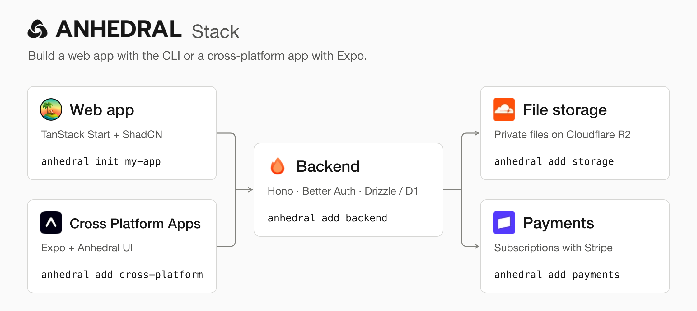

# Anhedral CLI

Build an app one addition at a time. Generated applications are editable source. Start with a TanStack Start web app and ShadCN components. Add a backend when you need an API, authentication, or a database. Then choose storage, payments, or both.

<picture>
  <source media="(prefers-color-scheme: dark)" srcset="https://raw.githubusercontent.com/anhedral/anhedral-cli/staging/docs/assets/anhedral-stack.png">
  
</picture>

**Upcoming** — `anhedral add cross-platform` will add an Expo client with Anhedral UI.

## How to use

Create and run a web app locally without an account.

```sh
anhedral init my-app
cd my-app
pnpm dev
```

From the project directory, add the services you need.

```sh
anhedral add backend   # Hono API, Better Auth, Drizzle + D1
anhedral add storage   # Private files on Cloudflare R2
anhedral add payments  # Subscriptions with Stripe
```

Use `--dry-run` to preview an addition. Compare the [example snapshots](https://github.com/anhedral/anhedral-cli/tree/staging/examples) or follow the [service setup guide](docs/capabilities.md) to configure providers and apply migrations.

Use the CLI directly or through the Codex and Claude Code plugin. To host on Anhedral, sign in, link a project, upload source, and deploy. [Platform workflow](docs/software-factory.md) · [Stack reference](docs/stack-standard.md)

Apache-2.0. Retain the included third-party notices when distributing generated source.
