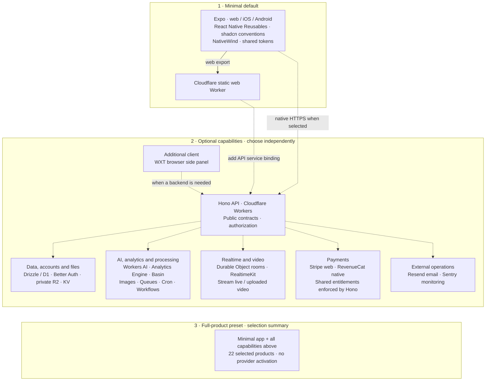

# Anhedral

[](https://github.com/anhedral/anhedral-cli/actions/workflows/ci.yml)
[](https://www.npmjs.com/package/anhedral)
[](LICENSE)

> 🚧 **Under construction.** Anhedral is in active development; features and APIs may change.

Anhedral creates TypeScript application workspaces and helps deliver them to your own cloud accounts. Start with a minimal universal frontend, add the services your product needs, and keep the source code, infrastructure, data and billing under your control.

The default is a **minimal Expo web/iOS/Android app** with React Native Reusables using shadcn conventions, NativeWind, shared styling, TypeScript, pnpm and Turborepo. Cloudflare hosts its static web export. Add API, accounts, data, files, payments or AI when needed; the resolver supplies dependencies. `--preset full-product` selects the complete compatible product foundation without activating services.

## Start locally

Use **Node.js 24.21.0 or newer** and **pnpm 10.34.5**. Initialize on Linux, macOS or WSL.

```sh
npm install --global anhedral

# Inspect the default selection; no writes or network requests.
anhedral init my-app --dry-run --json

# Generate source, install dependencies and start development.
anhedral init my-app
cd my-app
pnpm dev
```

Initialization creates the selected frontend and API foundations, downloads any required pinned upstream starter and installs dependencies. It does not provision cloud services or deploy the app. Follow the generated README for local addresses and any setup required by your selection. You can also run the CLI with `pnpm dlx anhedral@latest`; pin a version for repeatable automation.

## Progressive stack

Plain init creates only the Expo client, styling and tooling. Add capabilities for
real requirements, or use `--preset full-product` for the complete compatible
foundation. [See the concise stack page](docs/anhedral-stack.md).



| Need | Selection | Added automatically |
| --- | --- | --- |
| Minimal client | Plain init / `--preset minimal` | Expo, NativeWind, shared tokens and workspace tooling |
| Server logic | `--expo --hono` | Hono API and public contracts |
| Persistence | `--d1` | Hono and Drizzle/D1 |
| Accounts | `--better-auth` | Hono, a database and browser/native auth |
| AI | `--workers-ai` | Hono and AI binding; no implicit accounts or billing |
| `--analytics-engine` | Custom event analytics | Dataset binding and privacy-safe server event helper |
| `--images` | Image processing | Images binding and private raw-byte transform helper |
| `--realtimekit` | Audio/video conferencing | Meeting/participant-token helpers; client SDK/UI remains product work |
| `--video` | Uploaded video | Private Stream upload helper; implement processing checks and signed playback |
| Full product | `--preset full-product` | All compatible Cloudflare layers, WXT, payments, email and monitoring |

The full preset includes Expo, WXT side panel, Hono, Better Auth, D1, R2, KV,
Stripe, RevenueCat, Workers AI, Analytics Engine, Basin/Pipelines, Images,
RealtimeKit, Durable Object rooms, uploaded/live Stream video, Queues, Cron,
Workflows, Resend and Sentry. Bindings and helpers still need product logic,
provider setup and real acceptance. Init never provisions or activates services.

```sh
anhedral init complete --preset full-product --dry-run --json
anhedral add better-auth --cwd my-app --dry-run --json
anhedral add workers-ai images --cwd my-app --dry-run --json
anhedral add stripe revenuecat --cwd my-app --dry-run --json
```

Additions preserve edited source and reject conflicting regeneration or backend
relocation. Auth additions expose `/sign-in` and `/account` for product navigation.

## Choose the applications

Expo on Cloudflare is the minimal universal default. **Next.js on Vercel**
(`--next`) is the usual explicit web alternative; **Vinext on Cloudflare**
(`--vinext`) is also available. `--hono`, `--wxt` and `--electron` alone select
standalone applications; combine them with `--expo` when desired. Explicit Neon
or Clerk replace the full preset's D1 or Better Auth selections. OpenNext remains
an explicit compatibility profile (`--next --hosting=cloudflare`).

Every workspace uses pnpm and Turborepo with shared TypeScript/ESLint configuration
and one root lockfile. Public contracts appear with Hono; server auth, database
and billing packages appear only when selected. Root `pnpm dev` serves exported
Expo web on 3000 and Hono on 8787 when present. Native Metro uses
`pnpm --dir apps/mobile start`. Browser changes need a re-export; this is not HMR.
Keep SDK 57 pinned and provide build-time paths for static dynamic routes.

## Choose data and identity

| Selection       | Generates                                                             | Selection rule                                        |
| --------------- | --------------------------------------------------------------------- | ----------------------------------------------------- |
| `--d1`          | Shared Drizzle/SQLite database package and migrations                 | Cloudflare runtime; alternative to Neon               |
| `--neon`        | Shared Drizzle/PostgreSQL package using Neon HTTP                     | Server required; separate direct migration connection |
| `--better-auth` | Auth factory, database schema and server auth routes                  | Adds D1 when no database is selected; can use Neon    |
| `--clerk`       | Managed web identity integration and/or backend authentication helper | Alternative to Better Auth; server required           |
| `--local-data`  | Device-local persistence interface                                    | Implement platform adapters and synchronization       |

Database code lives in `packages/db`, including schemas and explicit migration tooling. Browser and device clients call server endpoints. Hosting audience protection and application resource authorization are separate from selecting an identity provider.

## Choose services and integrations

Private R2 and every service below are optional; full-product selects the complete compatible set. The generated scope column distinguishes bindings and Workers from SDK factories and integration guidance.

| Selection         | Purpose                           | Generated scope                                                                          |
| ----------------- | --------------------------------- | ---------------------------------------------------------------------------------------- |
| `--r2`            | Private files                     | R2 Worker binding and authorization guidance                                             |
| `--kv`            | Cache/configuration               | Eventually consistent Worker binding                                                     |
| `--realtime`      | WebSocket rooms                   | Separate Durable Object Worker; implement room authorization                             |
| `--neon-realtime` | Live PostgreSQL query results     | Server/client factories and Drizzle adapter; adds Neon; manual branch activation         |
| `--stream`        | One-to-many live video            | Cloudflare Stream WHIP/WHEP; server management factory; manual activation and product UI |
| `--queues`        | Background jobs                   | Producer, consumer and dead-letter configuration; implement processing/idempotency       |
| `--cron`          | Scheduled work                    | Separate Worker with an hourly starter schedule                                          |
| `--workflows`     | Durable multi-step work           | Separate Worker with a starter validation step                                           |
| `--workers-ai`    | Cloudflare inference              | Worker AI binding; implement model calls                                                 |
| `--openai`        | Direct OpenAI integration         | Server SDK factory in `packages/ai`                                                      |
| `--ai-sdk`        | AI streaming/provider abstraction | AI SDK exports with an OpenAI provider; alternative to `--openai`                        |
| `--resend`        | Transactional email               | Server SDK factory in `packages/email`                                                   |
| `--stripe`        | Payments/subscriptions            | Hono Checkout/portal/webhooks, DB projection and server entitlement guard                |
| `--revenuecat`    | Cross-store entitlements          | Native purchase/restore/manage plus Hono webhooks and shared entitlement projection      |
| `--sentry`        | Error/crash monitoring            | Integration boundary and redaction fields; initialize platform SDKs                      |
| `--posthog`       | Product analytics                 | Server analytics factory                                                                 |
| `--basin`         | Cloudflare analytical events      | Private stream binding and event helper                                                  |
| `--styling`       | Shared design tokens              | Light/dark tokens and Tailwind preset; automatically included with Expo/WXT              |

Live video (`--stream`), room messaging (`--realtime`) and live SQL (`--neon-realtime`) can coexist. See [live video setup and limits](docs/stack-standard.md#live-video-with-cloudflare-stream). PostHog and Basin can coexist with separate packages. Workers AI can accompany either AI SDK choice. Provider setup supports selected resources for Neon, Clerk, Resend, Stripe, RevenueCat, Sentry, PostHog and OpenAI; credentials, permissions and remaining owner steps are described in the [provider reference](docs/software-factory.md#provider-configuration).

### Composition rules

- Choose one web framework, one database and one identity provider; D1 and Better Auth are the defaults when data/identity is needed. `--openai` and `--ai-sdk` are alternatives.
- Database/auth, Stream and Neon Realtime selections need a compatible server. For mobile with PostgreSQL, use `--expo --hono --neon`.
- New server capabilities introduce Hono on Cloudflare, including for Next.js/Vercel. Existing apps retain runtime ownership during `add`.
- New Expo workspaces, explicit OpenNext, Queues, Basin, Images and Analytics Engine use Wrangler for the Cloudflare workspace. Other supported Cloudflare selections use Void. `add` rejects changes that switch an existing engine or relocate runtime source.
- Neon Realtime requires Neon and manual Realtime configuration. Stripe and RevenueCat are independently optional; WXT is an optional browser-extension interface.

Examples:

```sh
# Web with database-backed identity; Better Auth adds D1.
anhedral init my-app --better-auth

# Universal web/iOS/Android, shared API and PostgreSQL.
anhedral init my-app --expo --neon

# Vercel web with a Cloudflare API and private files.
anhedral init my-app --next --r2

# Live broadcasts with independent room messaging and SQL subscriptions.
anhedral init my-app --stream --neon-realtime --realtime
```

Inspect the full catalog and preview later additions:

```sh
anhedral registry list
anhedral registry view resend --json
anhedral add resend --cwd my-app --dry-run --json
anhedral add resend --cwd my-app
```

Generated entry points live in `apps/*`, shared code in `packages/*`, and Anhedral configuration in one root `anhedral.json`. Read the [source-only full-stack example](https://github.com/anhedral/anhedral-cli/tree/main/examples/full-stack) to see a larger project without creating services.

## Build and deliver

Implement the product, configure selected integrations and review database migrations. Then use the [software factory](docs/software-factory.md) to check provider access, connect the intended account and audience, commit source, ship and verify real user flows.

```sh
anhedral auth --status --json
anhedral doctor --providers --json
# Select the intended account and audience, then commit source/configuration.
anhedral connect --audience private --allow-email owner@example.com
git add .
git commit -m "Implement application and delivery configuration"
anhedral ship --dry-run --json
anhedral ship --json
anhedral verify --json
```

Replace the example member with the intended user. Private Cloudflare hosting requires Zero Trust and scoped Access permissions; native Vercel uses its own connect options in the factory. Implement a meaningful `test:live` script before `verify`. Actual shipping can create resources, apply reviewed deployment migrations and publish code. Provider permissions, account eligibility and usage charges still apply. A generated starter or successful deployment does not establish a working product.

Cloudflare and Vercel have automated delivery and provider evidence checks. Mixed delivery runs Cloudflare before Vercel and can partially succeed. Expo native shipping with an explicit platform returns verified EAS build artifacts; store submission is separate. Electron and extension projects include local build/package tooling, with signing and distribution handled through their platform workflows.

Use the [stack standard](docs/stack-standard.md) for destinations, compatibility, migration ownership, environment files and the remaining implementation requirements for every option. Exact dependency versions live in the [source catalog](https://github.com/anhedral/anhedral-cli/blob/main/src/dependencies.ts).

## Use with Codex

```sh
codex plugin marketplace add anhedral/anhedral-cli
codex plugin add anhedral@anhedral
```

Select **Try now**, or start with:

> Create a new project using [@Anhedral](plugin://anhedral@anhedral). Start by explaining the stack and asking me what it should be about.

The plugin ships six focused skills: Init, Dev, Design, Auth, Billing and Hosting. They guide implementation using the same stack and workflow. Its optional inspector shows project structure, setup, recorded delivery evidence and explicit service controls. Opening it does not deploy the app. The CLI works independently.

## Read next

| Document                                     | Use it to answer                                                         |
| -------------------------------------------- | ------------------------------------------------------------------------ |
| [Stack standard](docs/stack-standard.md)     | What should the application contain, and how should it fit together?     |
| [Software factory](docs/software-factory.md) | How do I turn a brief into a tested, delivered and maintainable product? |

The [verification record](docs/verification.md) keeps dated code reviews, provider evidence and remaining acceptance gaps together. Provider setup, CLI behavior, dashboard development and the release process are sections of the software factory.

Use `anhedral --help` and `anhedral help <command>` for command options. `--cwd` selects the project; `--json` produces structured output. Use its [provider configuration](docs/software-factory.md#provider-configuration), [CLI behavior](docs/software-factory.md#cli-behavior), [Codex dashboard](docs/software-factory.md#project-dashboard) and [release process](docs/software-factory.md#maintain-and-release-the-cli) sections for details.

## Work on the CLI

```sh
pnpm install --frozen-lockfile
pnpm build
node dist/bin.js init ../my-test-app --dry-run --json
pnpm test:all
```

`pnpm test:integration` installs and checks generated projects. Inspector development uses `pnpm plugin:build`, `pnpm plugin:check` and `pnpm plugin:preview`; its dependencies and lockfile live in `plugins/codex/inspector`. Building the checkout does not update an installed CLI or plugin. See the [contribution guide](https://github.com/anhedral/anhedral-cli/blob/main/.github/CONTRIBUTING.md) for the development and review process.

Anhedral is open source under the [Apache License 2.0](LICENSE). Generated applications are source code that developers can customize and license for their products, preserving upstream notices. Report bugs in [issues](https://github.com/anhedral/anhedral-cli/issues) and vulnerabilities through [private security reporting](https://github.com/anhedral/anhedral-cli/security/advisories/new).
