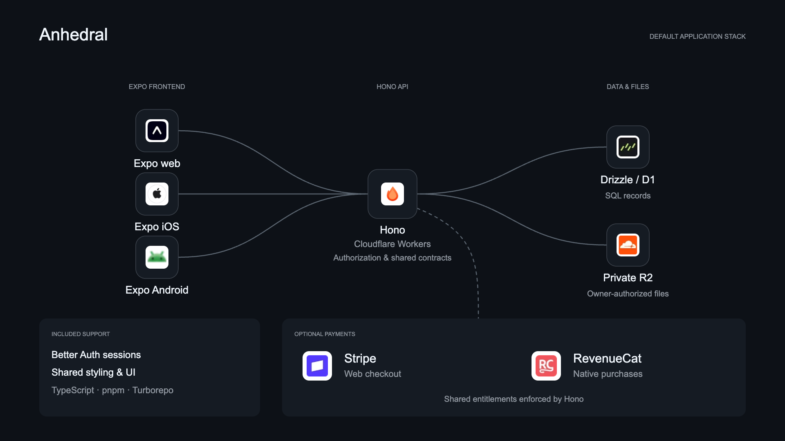

# Anhedral CLI

> [!WARNING]
> **Under construction.** Anhedral CLI is under active development. Commands, generated source and integrations are evolving, and breaking changes are expected. Commands and source-generation details are documented below.

Anhedral CLI scaffolds applications progressively: Next.js on Cloudflare Workers, a Hono API, Drizzle/D1 and Better Auth, then mobile, browser extension and desktop clients, storage, payments, realtime and AI. Each addition writes editable source into your project.

<picture>
  <source media="(prefers-color-scheme: light)" srcset="docs/assets/anhedral-stack-light.png">
  
</picture>

## Start a project

Start with a Next.js application configured for OpenNext on Cloudflare Workers, with Anhedral UI included as editable source:

```sh
anhedral init my-app
cd my-app
pnpm dev
```

Preview initialization with `anhedral init my-app --dry-run --json`, or use `--skip-install --no-git` to handle dependency installation and Git setup yourself.

Init creates `apps/web` plus shared tooling and tokens. It includes three reviewed web starter components (Button, Input and Label), official shadcn configuration and Anhedral UI metadata.

## Command help, scripts and shell completion

Run `anhedral --help` for a command index, then `anhedral help source upload`
or `anhedral source upload --help` for contextual options and examples. Init
accepts the directory before or after options. Use `--` to end option parsing;
for example, `anhedral init --dry-run --json -- -my-app` previews a literal
flag-looking directory. An explicit empty directory is rejected.

`--json` requests machine-readable results on stdout. Errors go to stderr as
`{error, code, nextAction}` with additive category/retryability information;
failures continue to exit 1. Post-commit errors include committed paths and explain
how to finish the failed follow-up without regenerating source. Human diagnostic
and progress messages do not enter JSON stdout.

Platform commands retain their compact JSON default for existing scripts. Use
`--human` for readable summaries, or keep `--json` explicit in automation.
`--quiet` suppresses ordinary output, including implicit Platform JSON, while
`--quiet --json` retains the requested JSON result. Errors remain visible.
`--non-interactive` prevents interactive approval polling; `login --resume` is
an explicit request to redeem an existing approval, including in CI. CI or a
redirected input/output stream never implies consent or starts a new polling flow.

Generate completion without network access or automatic shell-profile changes:

```sh
anhedral completion bash > ~/.anhedral-completion.bash
source ~/.anhedral-completion.bash
```

For zsh, generate `anhedral completion zsh > ~/.anhedral-completion.zsh`, initialize
completion with `autoload -Uz compinit && compinit`, then
`source ~/.anhedral-completion.zsh`. Add the source command to your shell profile
only if you want it enabled in future sessions. Completion includes local command,
capability and component names and file/directory arguments; it never discovers
remote projects or reads credentials.

## Link and upload source

Local staging includes browser-approved `login`, `link --project <uuid> --team <uuid>`,
`source upload`, `source status`, and `deploy plan|prepare|status`. Deployment
preparation runs an isolated build only after exact runtime admission; otherwise it awaits runtime. Platform access is disabled until separately
configured; upload never deploys or enables hosted admission. Run
`source upload --dry-run` offline to inspect the source archive. See
[Platform access and secure resumable upload](docs/software-factory.md#platform-cli-access-and-source-upload)
for credential storage, API origin selection and interruption recovery.

Manage linked-project configuration with `anhedral env list` or
`anhedral env import --environment staging --file .env.local --dry-run`.
Remove `--dry-run` to submit a private import after signing in and linking the
project. Files must be owner-only. Values never appear in CLI arguments, output
or saved retry state; production changes require Platform policy approval.
The optional plugin connects to Platform through OAuth for project tools and
browser-based secret imports. See [the Platform workflow](docs/software-factory.md#platform-cli-access-and-source-upload).
Use `anhedral staging status` or `anhedral staging deploy --candidate <uuid>` for
verified candidates, and `anhedral logs --environment staging --level error` for
redacted runtime events. Production release requests retain Platform approval.

## Build the stack progressively

Scaffold the API, database, authentication and Expo app as your product grows:

```sh
anhedral add hono
anhedral add database-auth
anhedral add expo native-ui
```

Or add that complete foundation to a newly initialized project in one step:

```sh
anhedral add expo native-ui --with-dependencies
```

Explore additional capabilities and preview their generated source:

```sh
anhedral stack list
anhedral add side-panel --with-dependencies --dry-run --json
```

The core progression is **Next.js → Hono → Drizzle/D1 + Better Auth**. After that, choose the capabilities your application needs:

| Add                               | Scaffolded source and configuration                                                                                      | Requires                                                    |
| --------------------------------- | ------------------------------------------------------------------------------------------------------------------------ | ----------------------------------------------------------- |
| `hono`                            | Hono API Worker, health route and web/API connection                                                                     | Next.js foundation                                          |
| `database-auth`                   | Drizzle schema and migrations, D1 binding, Better Auth and sign-in starter                                               | `hono`                                                      |
| `r2`                              | Private R2 binding and authenticated, owner-scoped file routes                                                           | `database-auth`                                             |
| `stripe`                          | Stripe subscription Checkout, signed webhooks and server-side access checks                                              | `database-auth`                                             |
| `realtime`                        | Durable events and resumable server-sent event streams                                                                   | `database-auth`                                             |
| `rtc`                             | Cloudflare Realtime SFU session and track API adapter                                                                    | `database-auth`                                             |
| `ai`                              | Workers AI text-generation route, authentication and daily quota                                                         | `database-auth`                                             |
| `expo`                            | Expo iOS/Android app with Better Auth and SecureStore session integration                                                | `database-auth`                                             |
| `native-ui`                       | NativeWind 4, shared theme styling and RNR Button/Text starter for Expo                                                  | `expo`                                                      |
| `revenuecat`                      | Mobile subscription SDK/UI, webhooks and server-side entitlement reconciliation                                          | `expo`, `stripe`                                            |
| `wxt`, with optional `side-panel` | WXT browser extension; `side-panel` adds Chrome Side Panel API support to render the extension in the browser side panel | `wxt` requires `database-auth`; `side-panel` requires `wxt` |
| `gpui`                            | Rust/GPUI native desktop application and build scripts                                                                   | `database-auth`                                             |

Include prerequisites explicitly or use `--with-dependencies` to add them in order. These dependencies define the Anhedral scaffold's composition rules. Additions preserve edited application source.

```sh
anhedral add r2 stripe realtime rtc ai
anhedral add revenuecat --with-dependencies
anhedral add wxt side-panel --with-dependencies
anhedral add gpui --with-dependencies
anhedral stack status
anhedral stack doctor
```

The CLI generates application source, bindings, configuration examples and migration tooling. Complete service activation with resource provisioning, credentials, reviewed migrations and runtime validation, then deploy the server applications and build/distribute the selected clients. Better Auth methods become usable after you explicitly enable and configure them. The [capability guide](docs/capabilities.md) covers setup and acceptance for each addition. `stack status` and `stack doctor` report the installed source and its completeness.

## Anhedral UI

```sh
anhedral ui list
anhedral ui add card --web
anhedral ui diff card --web
anhedral ui doctor --web
```

Anhedral UI is a small catalog and CLI over official shadcn on web and React Native Reusables on native. Components are copied into your application. Native resolution prefers a reviewed Anhedral extension when one exists, then RNR; unsupported components are reported. You own and customize the installed source.

For an existing Expo app, complete the upstream React Native Reusables NativeWind 4 setup first, then use `anhedral ui init --native`. Ambiguous workspaces require `--web`, `--native`, `--all` or an application-specific `--cwd`.

Install additional components as needed with `anhedral ui add`. Use `ui list` to explore availability, `ui diff` to review changes and `ui doctor` to check setup. Shared theme tokens connect the web and native design language while each platform receives its own component source.

## Documentation

See [stack standard](docs/stack-standard.md), [workflow](docs/software-factory.md), [UI commands](docs/ui.md) and [stack additions](docs/capabilities.md).

## Develop the CLI

For source development, run `pnpm install --frozen-lockfile && pnpm build`, then `node dist/bin.js init my-app`.

Apache-2.0. Generated applications are editable source that consumers may customize and license for their own products. Retain the applicable MIT notices for copied upstream UI source.
