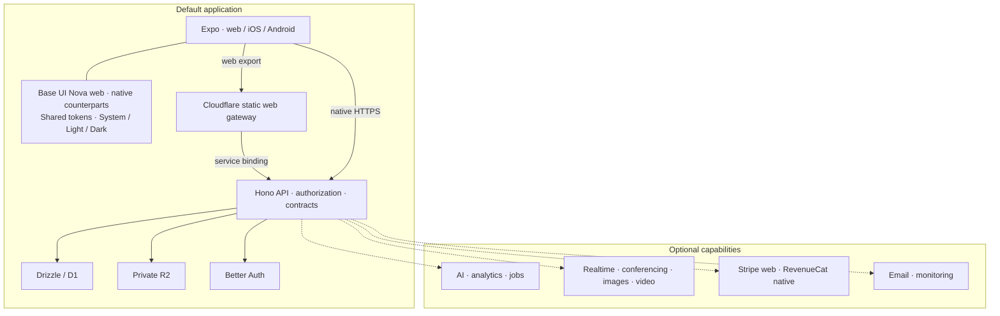

# Anhedral progressive stack

**Start with Expo, Hono, Drizzle/D1, private R2, Better Auth and shared UI. Add optional capabilities for real needs. Use `--preset minimal` for a client-only app.**

For Anhedral-hosted client applications, `--preset portal-full-stack` selects
Expo + Hono + Drizzle/D1 + private R2 + Better Auth + Anhedral UI + managed email.
Anhedral operates hosting and mail in its accounts. Clients supply no provider
keys. The initial email adapter supports account verification and password reset;
provisioned delivery and native return links need runtime acceptance.



The client uses the default Hono, Drizzle/D1, Better Auth and private R2 foundation. Lines summarize delivery and capability relationships. Dashed lines summarize optional
integrations, not every network request or deployment. The full-product group is a
selection summary, not another runtime. Grouped capabilities remain separate
services; their exact connections depend on the implemented product.

## Default foundation

| Part            | Default                                                               |
| --------------- | --------------------------------------------------------------------- |
| Client          | Expo + React Native + Expo Router                                     |
| Components      | Official Base UI Nova web + React Native counterparts                    |
| Styling         | Tailwind 4 web + native styles from shared tokens                                     |
| Workspace       | TypeScript + pnpm + Turborepo; shared TypeScript/ESLint configuration |
| Web hosting     | Static Expo export on a Cloudflare asset Worker                       |
| Native delivery | Local development; EAS and app stores when requested                  |

Plain `anhedral init my-app` includes Hono, Better Auth, Drizzle/D1 and private R2. Payments and other integrations remain optional. `--preset minimal` creates a client-only app. Static dynamic routes need build-time paths; SSR is a deliberate
alternative.

**Growth is additive.** For a deliberately minimal profile, `hono` adds API/contracts, `d1` adds SQL, `better-auth` adds server identity and `r2` adds private server-side storage. Dependencies resolve automatically; optional integrations never activate providers. Additions preserve edited source; backend or
hosting-engine migrations require explicit review.

## Payments and AI

| Add          | What it supplies                                                       |
| ------------ | ---------------------------------------------------------------------- |
| `stripe`     | Web Checkout/customer portal; Hono, identity and durable billing state |
| `revenuecat` | Native purchase/restore/manage flows; shared identity and entitlements |
| `workers-ai` | AI binding on the selected Hono foundation; no implicit subscriptions     |

Stripe and RevenueCat are independent. Hono verifies webhooks, reconciles provider
state and enforces paid access. Native purchases use Apple/Google billing;
RevenueCat synchronizes subscription state. Client purchase results never authorize
server operations. AI routes still need models, validation and usage limits.

## Services, add-ons and alternatives

| Capability                   | Selection                                                                 | Scope                                                                     |
| ---------------------------- | ------------------------------------------------------------------------- | ------------------------------------------------------------------------- |
| Analytics                    | `analytics-engine`, `basin`                                               | Event dataset/helper; private Pipelines stream                            |
| Images                       | `images`                                                                  | Binding and private raw-byte transform helper                             |
| Video                        | `video`, `stream`                                                         | Private uploaded-video helper; WHIP/WHEP live input helper                |
| Conferencing                 | `realtimekit`                                                             | Server meeting and participant-token helpers                              |
| App messaging                | `realtime`                                                                | Durable Object room Worker                                                |
| Jobs                         | `queues`, `cron`, `workflows`                                             | Queue/DLQ, scheduled and durable Worker foundations                       |
| Cache                        | `kv`                                                                      | Eventually consistent configuration/cache                                 |
| Extension                    | `wxt`                                                                     | Browser side panel API, entrypoints and permissions                       |
| Operations                   | `resend`, `sentry`                                                        | Email factory and monitoring integration boundary                         |
| **Next.js on Vercel**        | `next`                                                                    | Usual explicit web frontend alternative                                   |
| **Vinext on Cloudflare**     | `vinext`                                                                  | Additional explicit web frontend alternative                              |
| Data / identity alternatives | `neon`, `clerk`                                                           | Replace D1 / Better Auth                                                  |
| Specialized additions        | `neon-realtime`, `openai` / `ai-sdk`, `posthog`, `electron`, `local-data` | Live SQL, alternative AI, product analytics, desktop or local persistence |

**Full-product includes:** Expo, WXT, Hono, Better Auth, D1, R2, KV, Stripe,
RevenueCat, Workers AI, Analytics Engine, Basin, Images, RealtimeKit, Durable Object
rooms, uploaded video, live Stream video, Queues, Cron, Workflows, Resend and Sentry.
Explicit Next.js/Vinext, Neon and Clerk replace their corresponding preset defaults.

Cloudflare hosts selected web/API, data, storage, AI and media services. Payment
providers, app stores, Resend, Sentry and Vercel remain external. Media travels
directly between clients and media services; Hono handles authorization and token
issuance. Provider activation, product routes/UI and real acceptance remain work
after scaffolding—especially room authorization, media clients and job processing.

```sh
anhedral init my-app
anhedral add better-auth --cwd my-app --dry-run --json
anhedral init complete --preset full-product --dry-run --json
```

Deployable code lives in `apps/*`; shared code lives in `packages/*`. Contracts,
database, auth, billing and service packages appear when selected. Small apps avoid
unneeded infrastructure; complex products use the same boundaries with more
capabilities.
