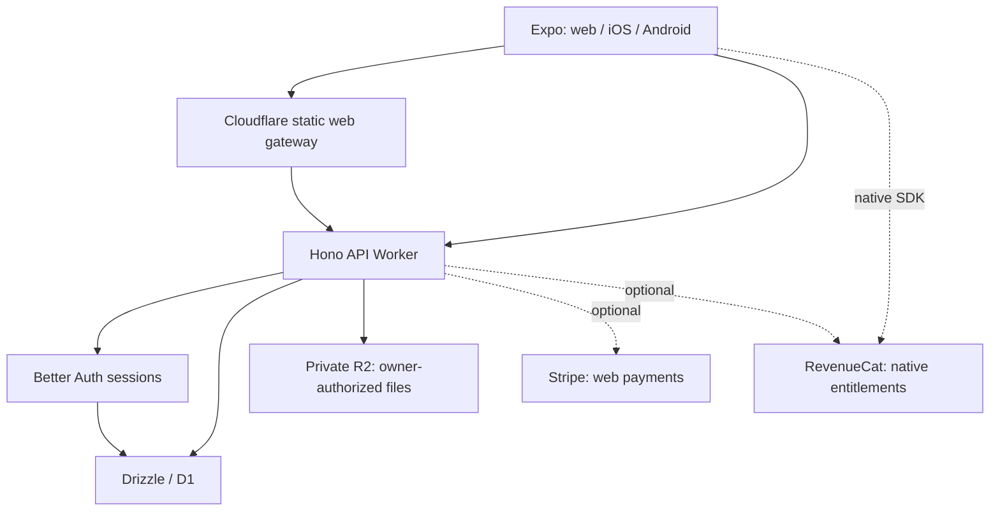

# Anhedral application stack

All application data and authorization belongs behind Hono. Native clients use the configured HTTPS API; browser API transport goes through the gateway. Source generation is separate from resource provisioning, migration and deployment. Stripe and RevenueCat are the only optional additions. See [stack standard](stack-standard.md) and [workflow](software-factory.md).
