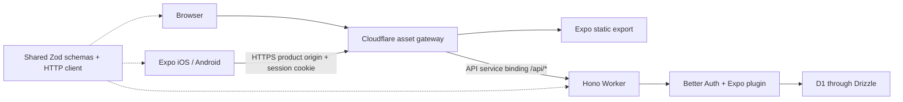

# Universal reference architecture

One Expo Router application in `apps/mobile` supplies static web routes and native iOS/Android bundles. Hono in `apps/api` owns identity and persistence. This example selects D1/Drizzle and Better Auth; this earlier reference predates the full-profile default. Current plain init also includes private R2.

Browser auth uses same-origin cookies. Native auth uses an explicit trusted application URL scheme, SecureStore and a cookie callback evaluated for each request. Native-only modules resolve through `.native.ts`; they do not enter the browser auth client. Public `EXPO_PUBLIC_API_URL` is a build input; it contains no server credentials. The API validates sessions and never trusts caller-supplied identity headers.

The gateway only serves assets and transports API calls. Its upstream is a fixed service binding; responses disable caching, preserve cookies and do not enable cross-origin browser credentials. API deployment precedes the asset gateway. Build does not provision resources or apply database migrations.

Web rendering is static on pinned SDK 57. The example uses fixed routes. New dynamic URL segments need build-time parameters or a deliberately selected routing/rendering strategy. The production-like Wrangler preview requires re-exporting browser changes; Metro supplies the separate native development loop.

This reference does not implement billing, shared purchase entitlements, social OAuth or the portal publisher. Installed-device behavior, native signing, EAS/store releases and live Cloudflare deployment have separate acceptance requirements.
